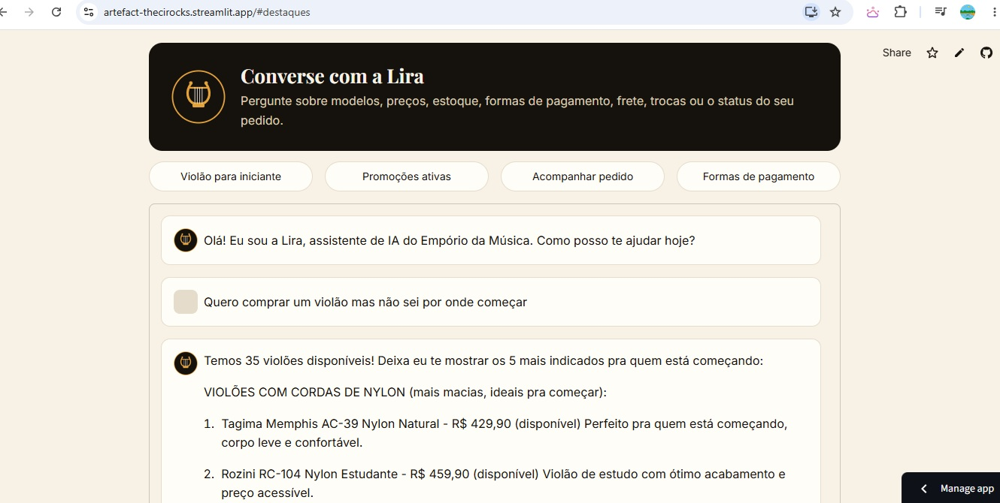

# 🎵 Lira — Assistente de AI do Empório da Música

Lira é uma agente de atendimento por mensagens de texto do Empório da Música, loja fictícia de instrumentos musicais em Campo Grande/MS.

> Desafio Técnico — AI Engineer @ Artefact

🔗 **Demo online:** [artefact-thecirocks.streamlit.app](https://artefact-thecirocks.streamlit.app/)




---

## Setup

```bash
# 1. Clone o repositório
git clone https://github.com/thecirocks/artefact_2.git
cd artefact_2

# 2. Crie e ative o ambiente virtual
python -m venv venv
source venv/bin/activate

# 3. Instale as dependências
pip install -r requirements.txt

# 4. Configure a API key
cp .env.example .env
# Edite o .env e adicione sua ANTHROPIC_API_KEY

# 5. Rode o agente
python agent.py

# 6. Rode os testes
python -m pytest tests/test_tools.py -v          # 40 testes unitários (grátis)
python -m pytest tests/test_integration.py -v     # 20 testes de integração (usa API)
```

---

## Decisões Técnicas

### Framework e Abordagem do Agente

| Decisão | Escolha | Justificativa |
|---|---|---|
| Acesso a dados | **Function calling** | Dados pequenos (65 produtos, 20 pedidos). Text-to-SQL e RAG adicionam complexidade sem ganho real |
| Políticas da loja | **System prompt direto** | Documento curto (~8 páginas). Injetar no system prompt é mais confiável que RAG com embeddings para esse volume |
| Modelo e provedor | **Claude Sonnet 4.5** (Anthropic) | Bom equilíbrio custo/qualidade para function calling. ~$0.03 por conversa - Adicinei USD 5 para esse case |
| Interface | **CLI + Streamlit** | CLI para desenvolvimento e testes. Streamlit para demo online com deploy gratuito no Streamlit Cloud |
| Histórico de conversa | **Em memória** | Mantido durante a sessão para conversas multi-turno. Sem persistência em disco — suficiente para o escopo |
| Tratamento de dados | **Nenhum pipeline ETL** | Dados fornecidos já estão limpos: sem nulls relevantes, tipos consistentes, specs em JSON válido |

### Arquitetura

O agente opera em um loop de function calling:

1. Usuário envia mensagem
2. Mensagem + system prompt + histórico vão para a API
3. API decide se precisa chamar uma tool ou responder direto
4. Se chamou tool → executa a função → envia resultado de volta → API compõe resposta final
5. Resposta vai pro usuário

### Tools Implementadas

| Tool | Função |
|---|---|
| `buscar_produtos` | Busca por nome, categoria, faixa de preço |
| `consultar_produto_detalhe` | Specs, promoção ativa, estoque de um produto |
| `consultar_pedido` | Exige 3 identificadores (pedido + email + nome) por segurança |
| `listar_promocoes_ativas` | Retorna apenas promoções com is_active=1 |
| `listar_categorias` | Lista categorias com contagem de produtos disponíveis |

### Prompt Engineering

- System prompt versionado em `prompts/system_prompt.txt`
- Políticas da loja injetadas com tags XML (`<politicas>`, `<format_rules>`)
- Regras numéricas explícitas (max 5 produtos por resposta, max 2-3 parágrafos)
- Fallback padrão: "entre em contato com suporte@emporiodamusica.com.br"

---

## Findings dos Dados

Durante a análise exploratória, identifiquei pontos de atenção tratados nas tools:

1. **Estoque zero com status ativo** — product 96 (Giannini GF-3D) tem `stock_quantity=0` mas `status=active`. Tool trata como "temporariamente indisponível"
2. **Produtos descontinuados** — products 113 e 136 com `status=discontinued`. Não são oferecidos como opção de compra
3. **Produto coming_soon** — product 130. Agente informa que está chegando
4. **Promoções** — das 25 cadastradas, apenas 4 estão ativas (IDs 12, 14, 19, 24). As outras 21 são expiradas. Agente nunca promete desconto que não existe mais
5. **Inconsistência fictícia** — Pedido 3 contém product 130 (coming_soon) com quantity=2. Ignorado por ser dado fictício

---

## Testes e Avaliação

### Estratégia de Testes

| Tipo | Quantidade | O que valida |
|---|---|---|
| **Unitários** | 40 (8 por função) | Funções isoladas: happy path, erros, edge cases, prompt injection |
| **Integração** | 20 | End-to-end com API: seleção de tool, system prompt, prompt injection, edge cases |
| **Conversas-exemplo** | 5 | Multi-turno com avaliação manual de cada resposta |

### Métricas de Avaliação (Data Annotation)

Cada conversa-exemplo foi avaliada manualmente com rubrica de 7 dimensões:

- **Overall** — qualidade geral da resposta
- **Tone** — tom adequado ao contexto
- **Clarity** — clareza e objetividade
- **Accuracy** — dados corretos em relação ao banco
- **Policy Compliance** — aplicação correta das políticas da loja
- **Tool Selection** — escolha da tool correta
- **Hallucination** — ausência de informação inventada

Resultados: 20/20 testes de integração passando (100%). Conversas-exemplo com scores 10/10 em todas as dimensões.

### Bugs Encontrados e Corrigidos

- **numpy bool not JSON serializable** — pandas retorna `numpy.bool_` que `json.dumps` não serializa. Corrigido com `NumpyEncoder` customizado
- **Devolução fora do prazo** — agente aceitava devoluções de pedidos entregues há meses. Corrigido adicionando cálculo de `dias_desde_entrega` e campo `elegivel_devolucao` na tool `consultar_pedido`

---

## Limitações Conhecidas

- Histórico de conversa não persiste entre sessões
- Sem autenticação de clientes (confia nos dados informados)
- Não calcula frete real (apenas informa prazos genéricos das políticas)
- Sem rate limiting ou controle de custos em produção
- Respostas podem variar entre execuções (natureza não-determinística do LLM)

## O Que Faria Com Mais Tempo

- **WhatsApp**: integração via API do WhatsApp Business
- **Multi-agente**: subagents para tarefas específicas (venda, pós-venda, suporte) com human-in-the-loop para aprovações
- **Pós-venda ativo**: retargeting, pedido de avaliação do atendimento, acompanhamento de entrega
- **Privacy by design**: há riscos de segurança com dados de clientes expostos nas tools — implementar controle de acesso real
- **Observabilidade**: monitoramento de latência, custo por conversa, taxa de fallback
- **RAG + Text-to-SQL**: para escalar com catálogos maiores (1000+ produtos)
- **Testes**: aumentar cobertura com cenários adversariais e A/B testing de prompts

---

## Uso de IA

Utilizei o **Claude** (Anthropic) como assistente para interagir comigo no momento de pré desenvolvimento - definição de escopo, problema, entregáveis e arquitetura, além de blocos de código maiores e complexos;

A IA foi usada como acelerador, não como substituto. Todas as decisões de arquitetura, avaliação de respostas e validação dos dados foram feitas por mim.

---

## Estrutura do Projeto

```
artefact_2/
├── agent.py                  # Orquestrador principal (loop de function calling)
├── config.py                 # Configurações (API key, modelo)
├── data_loader.py            # Carregamento singleton dos CSVs
├── app.py                    # Interface Streamlit (demo online)
├── generate_examples.py      # Script para gerar conversas-exemplo
├── requirements.txt          # Dependências
├── data/                     # CSVs e PDF de políticas
├── prompts/                  # System prompt versionado
│   └── system_prompt.txt
├── tools/                    # Implementação das 5 functions
│   └── functions.py
├── examples/                 # 5 conversas-exemplo com avaliação
└── tests/                    # 40 unitários + 20 integração
    ├── test_tools.py
    ├── test_integration.py
    └── test_results.log
```
